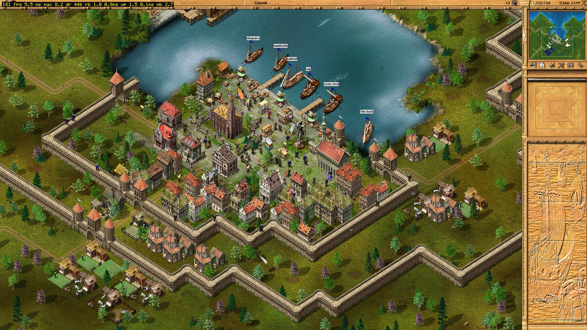

# Patrician III D3D11 renderer

A replacement for `ddraw_Dll.dll`, the graphics library of *Patrician III*, built on Direct3D 11. It runs the game at 16:9 resolutions up to 2560×1440, in a borderless or normal window, without the original frame limit. The game executable is not modified on disk.



*Gdańsk at 2560×1440, frame counter enabled.*

> **Beta, work in progress.** The renderer is playable but not finished. Crashes, error messages and drawing errors are expected, especially in game situations that have not been tested yet. Testers and feedback are very welcome.

## Testing and feedback

If the game stops, shows an error message or draws something wrong, please [open an issue](https://github.com/onethree7/patrizier3_d3d11/issues) with:

- the exact text of the error message (the window title and the message, for example `sgl_DrawBitmapRect unsupported: ...`), or a screenshot of the drawing error;
- what you were doing in the game when it happened (city view, sea battle, menu, loading a save, ...);
- your game version (GOG, Steam or modloader), the renderer release and your `high_res.ini`;
- your graphics card and screen resolution;
- if possible, the save game that reproduces it.

Comparison screenshots with the original `ddraw_Dll.dll` help a lot with drawing errors.

## Features

- Game resolutions 1280×1024, 1600×900, 1920×1080 and 2560×1440, selectable in the in-game options. The city view, top bar and side panels use the full width.
- Wide fast-forward map and widened menu backgrounds for 16:9.
- Borderless mode, or a normal window that can be moved, resized and maximized.
- Scaling to any screen size with the aspect ratio kept.
- Adjustable or unlimited frame rate and an optional on-screen frame counter.
- Works with the GOG and Steam releases and with the P3Modding modloader.
- Starts under Wine, including macOS with the Game Porting Toolkit.

## How it works

*Patrician III* (2003) does all of its drawing through `ddraw_Dll.dll`, the "SGL" library: sprites, map tiles, menus, text and clip regions all go through its 180 exports. The original draws on the CPU into DirectDraw surfaces, supports 4:3 and 5:4 modes up to 1280×1024 and limits the game to 50 frames per second.

This library provides the same exports. The game calls them with the same arguments as before; the images are kept in GPU textures, drawn with shaders that use the original blending formulas and presented through a DXGI swap chain.

**Resolutions.** The renderer adjusts the game's resolution handling in memory so the options menu offers the 16:9 sizes and the game lays out its views for them. Before changing anything it checks the original bytes at each place; if another mod has changed them, it leaves the game unpatched and the game stops with its graphics error.

**Scaling.** The game draws at the render size; the finished frame is scaled to the screen or window. A 1920×1080 game fills a 2560×1440 monitor by a factor of 4/3; at equal sizes the image is shown 1:1. Each screen pixel takes the nearest game pixel and only pixels on the edge between two game pixels are blended, so text and lines stay even at non-integer factors. The 800×600 menus are scaled into the render size and centred.

**Frame rate.** The game's timing follows the system clock, so the frame limit affects smoothness only. `max_fps` sets a different limit or removes it. In the busiest city views at 2560×1440 the renderer reaches about 180 fps on a current PC; it skips sprites outside the visible area early, batches draws and transfers only changed regions between CPU and GPU.

**Accuracy.** Comparison tests run every drawing function over its parameter space with the original library and the replacement and compare the pixels: all blend modes, colour flags and constant colours, stretching, clipping, fills, text, and every image in the game archive. Where the original reads or writes outside its own buffers or has a defect in its pixel loops, the replacement deliberately differs; these cases are listed with the reason in `tests/sweep-accepted.json`.

## Supported versions

| Version | Status |
|---|---|
| GOG | supported |
| Steam | supported |
| [P3Modding modloader](https://github.com/P3Modding/p3-lib) (`Patrician3_modloader.exe`) | supported; remove the modloader's `high_res.dll` from `mods\` |

All three contain the same game build. The modloader loads every file in `mods\` regardless of its extension, so `high_res.dll` has to be removed, not renamed; it changes the same code as this renderer. Other P3Modding mods work alongside.

## Installation

1. Back up the game's original `ddraw_Dll.dll`.
2. Extract the release zip into the game folder, next to `Patrician3.exe`:

   ```text
   Patrician III\
     Patrician3.exe
     ddraw_Dll.dll
     high_res.ini
     renderer-assets\
       fast-forward-map\
       wqhd-side-fill\
   ```

3. Start the game. `Patrician3.exe /nointro` skips the intro videos.

To uninstall, restore the original `ddraw_Dll.dll`.

## Configuration

`high_res.ini` next to the game executable:

```ini
[display]
width=1920
height=1080
mode=borderless
max_fps=0
vsync=1
show_fps=0
exact_blend=0
```

| Key | Values |
|---|---|
| `width`, `height` | 1280×1024, 1600×900, 1920×1080 or 2560×1440. Changing the resolution in the game's options updates the file. |
| `mode` | `borderless` (default) or `windowed` |
| `max_fps` | `0` removes the limit, `10`–`1000` sets one; without the key the game keeps its own limit of 50 |
| `vsync` | `1` (default) waits for the vertical blank on every frame, so frames are evenly paced and capped at the refresh rate; `0` does not, and only `max_fps` limits the frame rate |
| `show_fps` | `1` shows the frame rate and frame times in the top-left corner. Debug builds also show draws (`dr`), the draw calls and queue flushes that recorded them (`dc`, `fl`; of the flushes, `t` switched target, `o` were overlapping translucent draws, `u` were texture uploads) and transfers, and write `sgl_readbacks.log` next to `high_res.ini`, which every two seconds lists the GPU readbacks per frame by SGL export, calling game address and surface size |
| `exact_blend` | `1` blends translucent draws with the original integer formulas through a copy of the target, which splits a frame into many GPU passes; `0` (default) uses hardware blending, at most one color step apart, and is much faster on tile-based GPUs such as Apple Silicon |

Other keys and sections are ignored; a key given twice takes its last value.

## Building

Requirements: Windows, CMake 3.25 or newer, Visual Studio 2022 with the C++ desktop workload (x86 tools and a Windows SDK), and Node.js for the test scripts. The library is 32-bit, like the game.

```powershell
cmake -S . -B build -G "Visual Studio 17 2022" -A Win32
cmake --build build --config Release
ctest --test-dir build -C Release --output-on-failure
node tests/test-exports.mjs
```

`-DSGL_DIAGNOSTICS=ON` builds the debug variant with the renderer counters and `sgl_readbacks.log` behind `show_fps`; the default `OFF` writes no log files.

The DLL is written to `build\Release\ddraw_Dll.dll`. For a working installation, copy the contents of `assets\` into the game's `renderer-assets\` folder.

The unit tests need no game files. The comparison with the original library needs a game folder that contains the original `ddraw_Dll.dll`, `AIM.dll`, `archiver.dll` and `p2arch0_eng.cpr`:

```powershell
node tests/run-sweep.mjs build\Release\sgl_sweep_oracle.exe "<game folder>" build\Release\ddraw_Dll.dll
```

The image check runs when `--names <file>` names a text file with one archive path per line, for example `images\sidemenu\frohr_pirat01.bmp`.

## License

The source code is licensed under the [Apache License 2.0](LICENSE).

The images in `assets\` are derived from the graphics of *Patrician III* and are not covered by that license; the rights of their owners are unaffected. *Patrician III* is a trademark of its respective owners. This project is not affiliated with them.
